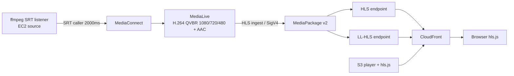

# thmanyah live streaming pipeline

End to end live streaming on AWS, all in Terraform:

**SRT → MediaConnect → MediaLive → MediaPackage v2 → CloudFront → web player.**

Clone it, run one script, get a URL that plays the stream. A second script tears it all back down to $0.

## Playback link

`./scripts/create-channel.sh` provisions everything, starts the stream, and prints the player URL (something like `https://<dist-id>.cloudfront.net/`). Open that in a browser.

The URL only works while the channel is running. Once you stop or destroy the stream the CloudFront domain stays, but there's nothing behind it (see [Cost](#cost)). Each fresh deploy mints its own domain, so the link isn't permanent by design.

## Architecture



## Run it

You need **terraform**, the **aws cli** configured for your account, and a region that has AWS Elemental plus MediaPackage v2 (default `eu-west-1`; `us-east-1`, `us-west-2`, `ap-southeast-2`, `ap-northeast-1` work too). The credentials have to be able to create MediaConnect/MediaLive/MediaPackage, EC2, CloudFront and IAM roles, so PowerUser plus `iam:CreateRole`/`iam:PassRole`, or admin.

```bash
./scripts/create-channel.sh     # apply + start the stream, print the URL (first run ~15-20 min for CloudFront)
./scripts/stop-channel.sh       # stop the stream, keep the infra, cost drops to near zero
./scripts/destroy-channel.sh    # stop then destroy, back to $0
./scripts/probe.sh              # quick check: player loads, manifest has the 3 rungs
```

`create-channel.sh` is safe to re-run; it resumes a stopped stream. State is local (`terraform/terraform.tfstate`), nothing else has to pre-exist. Point it at another region with `TF_VAR_region=us-west-2 ./scripts/create-channel.sh`.

## Configuration choices

| Area | Choice |
|---|---|
| Ingest | SRT, MediaConnect caller mode, 2000 ms latency |
| Source | self-hosted ffmpeg SRT listener on a t3.small (there's no public SRT source you can actually pull from) |
| Codec | H.264 / AVC, QVBR |
| Ladder | 1080p@5M (High), 720p@3M (High), 480p@1.5M (Main), all ≤30 fps, AAC-LC 128k stereo |
| GOP | 2 s, closed, IDR per GOP |
| Segments | 4 s |
| Packaging | MediaPackage v2, HLS endpoint plus LL-HLS endpoint, 60 s manifest window |
| CDN | CloudFront, 2 origins (`/out/*` to MediaPackage, `/` to the S3 player via OAC) |
| Cache / TTL | `.m3u8` playlists cached 0 to 2 s, segments cached long (they never change) |
| Player | plain HTML5 plus vendored hls.js, same origin, native HLS fallback for Safari |

## How each stage works

**Ingest.** A small EC2 box runs ffmpeg as an SRT listener looping a sample clip. MediaConnect, in SRT caller mode, dials it at 2000 ms latency (the retransmit budget is roughly 4x the round trip). There's no public SRT source to pull from, so we host our own, which is both reliable and reproducible. If the sample can't be downloaded the encoder generates colour bars and a tone instead, so there's always something on air.

**Transcode.** MediaLive takes the MediaConnect input and produces a 3 rung H.264 QVBR ladder (1080/720/480) with one shared AAC track. GOP is 2 s closed with an IDR per GOP, so every 4 s segment starts on a keyframe and the player can switch rungs cleanly. Frame rate is pinned at 30 so we stay in the cheaper billing tier.

**Package.** MediaLive sends a standard HLS feed to the MediaPackage v2 channel over HTTPS (Basic PUT, signed with SigV4 from the channel's IAM role, no stored passwords). MediaPackage repackages to CMAF and exposes two endpoints off the same channel: a normal HLS manifest (60 s window) and a low latency HLS one.

**Deliver.** CloudFront sits in front of both. `/out/*` goes to MediaPackage, with the `.m3u8` playlists on a 0 to 2 s cache so the live edge stays fresh and the segments cached long since they never change. `/` serves the player out of a private S3 bucket that only CloudFront can read (OAC). Player and stream share one domain, so there's no CORS to deal with.

**Play.** A single `index.html` loads hls.js (vendored and pinned) and plays the manifest from a relative path on the same host. Safari and iOS use native HLS, everything else uses hls.js with low latency mode on.

## Cost

This spins up real, billable resources. Running costs roughly **$1.75/hr** (MediaLive is most of it). `stop-channel.sh` drops that to about cents a day (the Elastic IP still bills ~$0.005/hr while it's allocated). Only `destroy-channel.sh` gets you to a true **$0**. Run destroy when you're done.

## Bonus bits

- The whole stack is Infrastructure as Code (Terraform, using both the `aws` and `awscc` providers).
- LL-HLS runs as a second MediaPackage endpoint alongside the standard HLS one.

## Layout

```
terraform/   all the resources, flat, local state
player/      index.html and the vendored hls.min.js
source/      ffmpeg source script, systemd unit, cloud-init template
scripts/     create / stop / destroy / probe
```
